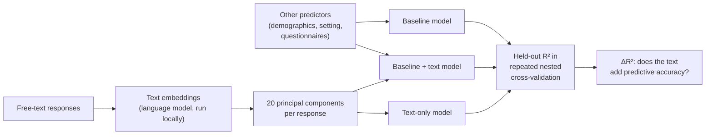

# Wiki: how the analysis works and how to reproduce it

[Author note: This wiki is AI-generated (Claude Code, Opus 5.5). For the AI
usage statement for the study itself, please see the respective section in the
manuscript.]

This wiki accompanies the article *"Free-text responses improve prediction of
mental health outcomes after psychedelic experiences"*
([`manuscript.pdf`](../manuscript.pdf), Supplementary Information:
[`manuscript_SI.pdf`](../manuscript_SI.pdf)).
It explains, without going deep into the code, what the analysis does and how
you can run it yourself.

**In one sentence:** participants described their psychedelic experiences in
their own words; we turned these texts into numbers with a language model and
tested whether they improve the prediction of mental health outcomes beyond
everything else we knew about the participants.

## The analysis at a glance

The same pipeline is shown in Figure 1 of the article ([`tex/workflow.pdf`](../tex/workflow.pdf)).

## Pages

1. [The study](1-The-study.md): datasets, free-text questions, outcomes, other predictors
2. [From text to numbers](2-From-text-to-numbers.md): text embeddings and principal components
3. [Models and evaluation](3-Models-and-evaluation.md): elastic net, cross-validation, ΔR² and its test, the additional analyses
4. [The synthetic data](4-The-synthetic-data.md): why this repository runs on synthetic data and how it was made
5. [Reproducing the analysis](5-Reproducing-the-analysis.md): what you need, how to run it, how long it takes
6. [Reading the results](6-Reading-the-results.md): the two manuscripts, the colours, how numbers get into the text
7. [Repository map](7-Repository-map.md): which file does what

## Two versions of the manuscript

| File | Data | What it is for |
|---|---|---|
| [`manuscript.pdf`](../manuscript.pdf), [`manuscript_SI.pdf`](../manuscript_SI.pdf) | **real** participant data | the article and its Supplementary Information: all reported findings |
| [`tex/manuscript_synthetic.pdf`](../tex/manuscript_synthetic.pdf), [`tex/manuscript_synthetic_SI.pdf`](../tex/manuscript_synthetic_SI.pdf) | **synthetic** data | the same text, filled by this repository's pipeline; shows that the code produces every number, table and figure |

Only the article (`manuscript.pdf`) reports findings. The synthetic version
demonstrates the pipeline; its numbers are not results about people.
